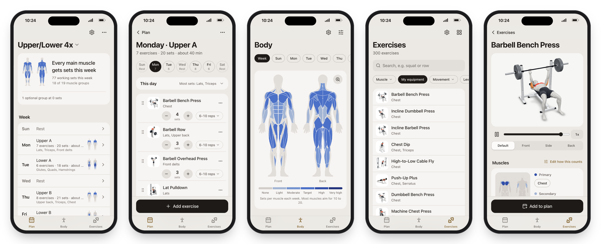

# Tenset

A phone-first, offline exercise library. Search about 300 exercises, filter by muscle, movement group and the equipment your gym has, and watch each one as a short loop of our own procedural 3D figure with the worked muscles highlighted. English and Ukrainian.

No accounts and no backend: the chosen language and equipment live in the browser (localStorage).

Live: https://tenset-app.vercel.app

<picture>
  <source media="(prefers-color-scheme: dark)" srcset="docs/screenshots/phones-dark.png">
  
</picture>

## Docs

- `docs/PLAN.md`: scope, architecture and every lead and owner decision (source of truth)
- `docs/FAMILIES.md`: motion templates, extension points, QA gates and the definition of done per exercise
- `docs/UI-CONTRACTS.md`: UI component contracts
- `CLAUDE.md`: hard rules (banned sources, licensing, copy tone)
- `ATTRIBUTION.md`: credits and third-party licenses (rendered at `/credits`)

## Stack

Vite, React 19, TypeScript, Tailwind 4, TanStack Router, Zustand + zod, three.js / React Three Fiber (lazy chunk), vite-plugin-pwa with our own service worker, Vitest, Playwright. Package manager: pnpm. Node 24 runs the `pipeline/*.ts` scripts directly.

## App commands

| What | Command |
|---|---|
| Dev server (add `--host` to open it on a phone) | `pnpm dev` |
| Owner review of animations | `pnpm dev`, then `/dev/review` (dev only) |
| Types, lint | `pnpm typecheck`, `pnpm lint` |
| Unit tests | `pnpm test` |
| Animation tests (slow, re-bake every loop) | `pnpm test:motion` |
| Cue originality and license allowlist | `pnpm test:cues`, `pnpm licenses:check` |
| Production build | `pnpm build` (fails if the service worker precache goes over 8 MiB) |
| End-to-end tests (desktop and iPhone profiles) | `pnpm e2e` |

## Media pipeline (build time only)

The figure, motions, loops and posters are generated locally and committed; CI never renders. Rendering needs Playwright Chromium on the Metal GPU (the scripts check for it).

| What | Command |
|---|---|
| Motion QA gates for every animated exercise | `node pipeline/motion/qa.ts` (`--only 101,107`, `--family F1`) |
| Re-bake compact motions | `node pipeline/motion/bake-motion.ts --only <ids>` (`--check` to compare only) |
| Bake loops and posters | `node pipeline/render/bake-loops.ts --qa qa/out/loops` (`--only <ids>`; a full run prunes stale files) |
| Stale-media check | `node pipeline/render/check-media.ts` |
| Approved renders unchanged | `node pipeline/render/verify-posters.ts` |
| README phone screenshots (after `pnpm build`) | `node pipeline/render/readme-shots.ts` |

An exercise shows its animation in production only when its record has `media.status: "loop"` (owner-approved). Dev shows every baked motion.

## Deploy

- Vercel deploys `main` automatically on every push. The build settings live in the Vercel dashboard (`pnpm build`, output `dist`).
- `vercel.json` sets the Content-Security-Policy and security headers, a one-year immutable cache for hashed assets, posters and loops, no-cache for the app shell and service worker, and the SPA rewrite to `index.html`. The CSP e2e test reads the policy from it.
- After a deploy, check the live headers with `curl -sI https://tenset-app.vercel.app/`.
- The Vercel Hobby plan is for non-commercial use only.

## License

Code: MIT. Data and media: CC BY 4.0. Third-party material and its licenses are listed in `ATTRIBUTION.md`.
