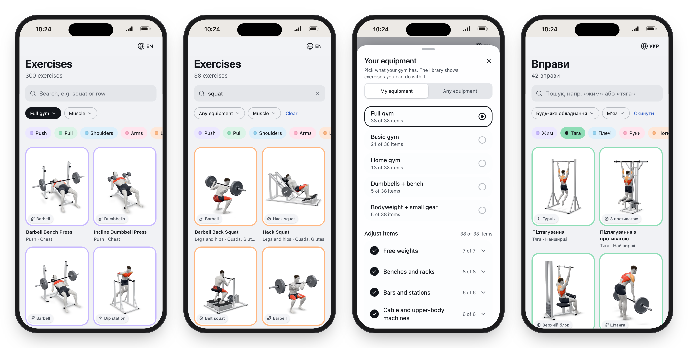

# Tenset

A phone-first, offline exercise library. Every exercise plays as a short loop of our own procedural 3D figure, with the worked muscles highlighted.

Live: https://tenset-app.vercel.app

<picture>
  <source media="(prefers-color-scheme: dark)" srcset="docs/screenshots/library-dark.png">
  
</picture>

## What it does

- **Search** about 300 exercises by name, common abbreviation (RDL, OHP), muscle or equipment. Ukrainian search also matches English names.
- **Filter** by muscle (tap it on a body map or pick from a list), by movement group (push, pull, shoulders, arms, legs, core), and by the equipment your gym has: start from a preset (full gym, basic gym, home gym, dumbbells and bench, bodyweight) and adjust single items.
- **Watch** each exercise on its card: the loop plays while the card is on screen, and the poster stays still under reduced motion. Exercises without an approved loop show their worked muscles on a body map.
- **English and Ukrainian**, picked from the toolbar. The first visit follows the browser language.
- **Works offline** after the first visit. Loops and posters are cached as you see them.

No accounts, no backend, no analytics. The chosen language and equipment stay in the browser (localStorage); nothing is sent anywhere.

## Docs

- `CLAUDE.md`: hard rules (banned sources, licensing, copy tone)
- `docs/FAMILIES.md`: motion templates, extension points, QA gates and the definition of done per exercise
- `docs/I18N.md`: translation rules and glossary
- `docs/PLAN.md`: content, motion and media decisions (its planner scope is historical)
- `ATTRIBUTION.md`: credits and third-party licenses (rendered at `/credits`)

## Stack

Vite, React 19, TypeScript, Tailwind 4, TanStack Router, Zustand + zod, three.js / React Three Fiber (dev review and the bake pipeline only), vite-plugin-pwa with our own service worker, Vitest, Playwright. Package manager: pnpm. Node 24 runs the `pipeline/*.ts` scripts directly.

## App commands

| What | Command |
|---|---|
| Dev server (add `--host` to open it on a phone) | `pnpm dev` |
| Owner review of animations | `pnpm dev`, then `/dev/review` (dev only) |
| Types, lint | `pnpm typecheck`, `pnpm lint` |
| Unit tests | `pnpm test` |
| Animation tests (slow, re-bake every loop) | `pnpm test:motion` |
| Cue originality and license allowlist | `pnpm test:cues`, `pnpm licenses:check` |
| Production build | `pnpm build` (fails if the service worker precache goes over 8 MiB) |
| End-to-end tests (desktop and iPhone profiles) | `pnpm e2e` |

## Media pipeline (build time only)

The figure, motions, loops and posters are generated locally and committed; CI never renders. Rendering needs Playwright Chromium on the Metal GPU (the scripts check for it).

| What | Command |
|---|---|
| Motion QA gates for every animated exercise | `node pipeline/motion/qa.ts` (`--only 101,107`, `--family F1`) |
| Re-bake compact motions | `node pipeline/motion/bake-motion.ts --only <ids>` (`--check` to compare only) |
| Bake loops and posters | `node pipeline/render/bake-loops.ts --qa qa/out/loops` (`--only <ids>`; a full run prunes stale files) |
| Stale-media check | `node pipeline/render/check-media.ts` |
| Approved renders unchanged | `node pipeline/render/verify-posters.ts` |
| README phone screenshots (after `pnpm build`; library, search, equipment sheet, Ukrainian) | `node pipeline/render/readme-shots.ts` |

An exercise shows its animation in production only when its record has `media.status: "loop"` (owner-approved). Dev shows every baked motion.

## Deploy

- Vercel deploys `main` automatically on every push. The build settings live in the Vercel dashboard (`pnpm build`, output `dist`).
- `vercel.json` sets the Content-Security-Policy and security headers, a one-year immutable cache for hashed assets, posters and loops, no-cache for the app shell and service worker, and the SPA rewrite to `index.html`. The CSP e2e test reads the policy from it.
- After a deploy, check the live headers with `curl -sI https://tenset-app.vercel.app/`.
- The Vercel Hobby plan is for non-commercial use only.

## License

Code: MIT. Data and media: CC BY 4.0. Third-party material and its licenses are listed in `ATTRIBUTION.md`.
